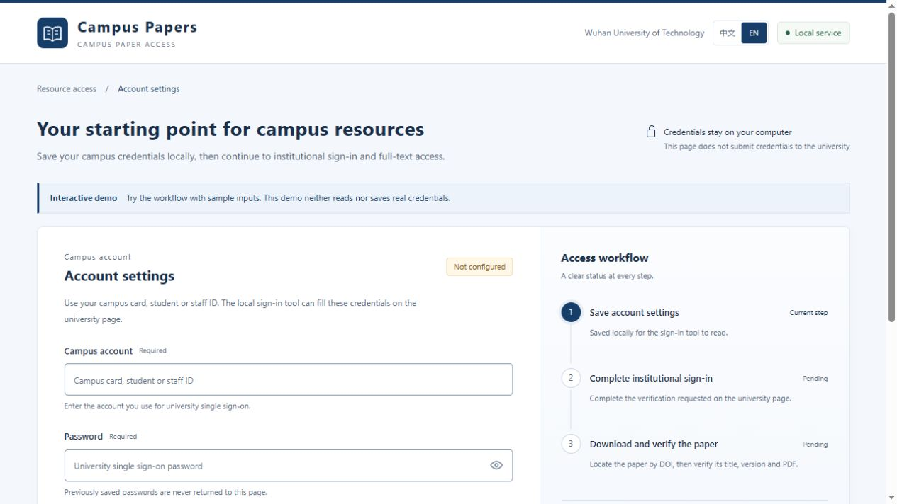
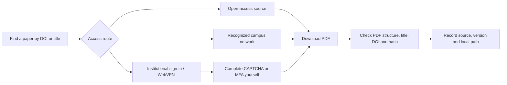

# Campus Library Papers

[简体中文](README.md) · **English**

A local workflow for institutional access, specific-paper retrieval, PDF verification and a clear handoff to your next research session.


[Download v2.0.0](https://github.com/PengyuLaider/WUT-Acadamic-Download/releases/tag/v2.0.0) · [Get started](#start-the-portal) · [Capabilities](#capabilities-and-limits) · [Outputs](#what-you-get) · [FAQ](#frequently-asked-questions)


**Local-first** · **Chinese / English** · **Python 3.10+** · **Optional Node 22+ browser tools** · **Wuhan University of Technology by default**

## Why this project exists

A DOI is only the start. Institutional authentication may live in a different browser session, a database may request human verification, and a saved file may be an HTML page, a supplement or the wrong paper. A later agent also needs to know where the task stopped.

Campus Library Papers connects those steps: configure credentials locally, choose an OA or institutionally authorized route, retrieve the requested paper, check its structure and identity, then record the source, version, path and verification state.

| Component | What you use it for |
|---|---|
| Local account portal | Save campus credentials with a visual form and see the next authentication step |
| Retrieval and verification tools | Locate papers by DOI, article URL or confirmed list; import PDFs and build an index |
| Agent skill | Follow a consistent process and retain progress when a person must complete verification |

**The portal manages account configuration. Authentication, paper download and verification continue through the corresponding tools.** These stages have separate states. Real institutional sign-in and article-specific downloads still need validation in the user's environment.

## Who it is for

- **Researchers and graduate students:** start with a DOI or reading list and reduce repeated access and file-organization work.
- **Research groups:** retain sources and file fingerprints for reading and review; keep full-text papers out of the public repository.
- **Agent-assisted workflows:** preserve the target, browser session, output directory and pending action across handoffs.
- **Developers and demonstrations:** preview form validation and status changes without entering real campus credentials.

## See the interface



Screenshots use demo data. [Mobile layout](docs/images/portal-mobile.jpg) · [Save feedback](docs/images/portal-saved.jpg) · [Showcase source](docs/index.html) · [Static demo source](docs/demo/index.html). Download the static pages to open them locally. GitHub file views show source; a separate GitHub Pages site has not been enabled.

## Capabilities and limits

| Capability | Current behavior |
|---|---|
| Account portal | Responsive local UI, validation, password visibility and status feedback |
| Metadata/OA | DOI, arXiv and supported biomedical identifiers; provider availability varies |
| Browser download | Institutionally authorized sessions, sequential downloads and human verification handoff |
| Archiving | SHA-256, source, local path, title, version and explicit verification status |
| Protected access | No paywall bypass, CAPTCHA solving or fabricated institutional identity |
| Authentication | Real school login must be validated in the user's environment |

## How the workflow works



The portal distinguishes configuration, authentication and paper verification. A saved configuration never marks authentication as complete automatically. Preprints, accepted manuscripts and published versions should be recorded separately.

## Start the portal

### Choose an entry point

| Your goal | Requirements | Entry |
|---|---|---|
| Preview the UI | Python 3.10+, or the downloaded static demo | `python campus_portal.py --demo` |
| Configure a local account | Python 3.10+ | `python campus_portal.py` |
| OA retrieval / PDF verification | Python 3.10+; pypdf for verification | OA and local-import commands below |
| Independent browser assistance | Node 22+, Edge / Chrome and a host that permits it | Browser commands below |
| Agent handoff | A skill-capable host with supported browser / file tools | [Agent skill](#continue-with-an-agent) |

Download and extract `campus-library-papers.zip` from [Releases](https://github.com/PengyuLaider/WUT-Acadamic-Download/releases), then open a terminal in that folder. Alternatively, clone the maintained main source.

Python **3.10+** is required. The UI uses the standard library; there is no npm build, external font, analytics script or remote credential service.

```bash
python campus_portal.py
```

Keep the terminal open and use the local browser page. Stop the service with **Ctrl+C**. Do not disable security software or restore a quarantined legacy launcher.

- Select **中文 / EN** in the header. Only the language preference is stored in browser local storage.
- Enter your campus account and password. The portal saves them in the local plain-text file `登录配置.private.json`.
- Existing credentials are not returned to the page. Blank fields preserve saved values; changing the account requires the corresponding password.
- The optional automatic submission setting permits one click only when no CAPTCHA is detected. CAPTCHA, QR-code and SMS verification remain your responsibility.

For a credential-free preview:

```bash
python campus_portal.py --demo
```

Or open [the project showcase](docs/index.html) or [the standalone static demo](docs/demo/index.html). The demo simulates saving in the current page and neither reads nor writes actual credentials. GitHub Pages may serve `docs/demo/`; it must not host the real credential service.

## Institutional sign-in and download

The independent browser CLI requires **Node 22+** and installed Edge or Chrome. Use it only where the host permits that automation; otherwise use the host's supported browser tools.

```bash
node skill-src/scripts/browser_dl.js --login --credentials 登录配置.private.json
node skill-src/scripts/browser_dl.js --url "ARTICLE_URL" --out papers --no-proxy
```

Keep authentication and download in the same browser profile. It does not automatically share sessions with your ordinary browser. Use `--no-proxy` only when a system proxy interferes with recognized campus access. Neither a successful network request nor an institutional logo proves access to the requested paper.

For OA retrieval and PDF verification:

```bash
python -m pip install -r requirements-dev.txt
python skill-src/scripts/paper_oa.py fetch "10.1016/j.esci.2023.100174" --out papers
python skill-src/scripts/paper_oa.py import-file "paper.pdf" --doi "TARGET_DOI" --title "FULL_TITLE" --out papers
python skill-src/scripts/paper_oa.py organize papers
```

The optional `pypdf` dependency checks PDF structure and extracts front matter for title/DOI matching. `saved_pending_verification` means the file exists but verification is incomplete. Scans, encrypted files, title variations and one-page documents may require manual review. Verification does not establish redistribution rights.

## What you get

```text
papers/
├── <paper>.pdf       retrieved or imported full text
├── manifest.jsonl   source, path, hash, version and verification information
└── index.csv        reading index built from registered records
```

`organize` processes registered records; it does not scan and import every PDF in a directory. A confirmed DOI list can be processed sequentially with `python skill-src/scripts/paper_oa.py batch "dois.txt" --out papers`.

| State | Meaning | Next action |
|---|---|---|
| `downloaded` / `exists` | File exists, hash is valid and local automatic identity checks passed | Read it and confirm the manuscript version and usage rights |
| `saved_pending_verification` | Saved, but parsing or identity evidence is incomplete | Complete verification; inspect the first page when necessary |
| `selection_required` | Candidates found; target not chosen | Select the intended paper |
| `need_user` | Human sign-in or verification is required | Complete it on the current page, then continue |
| `source_unavailable` | Metadata service or network failed | Resume later or choose another lawful source |
| `no_oa` | No OA location found through the queried routes | Check institutional access, a lawful alternative or document delivery |

Automatic verification does not grant redistribution rights. Record preprints, accepted manuscripts, published versions and supplements separately.

## Continue with an agent

[skill-src/SKILL.md](skill-src/SKILL.md) is the skill entry, named `campus-library-papers`. Install it using your host's supported method. The standalone skill does not include the root-level account portal.

Example task:

> Use the campus paper download skill to retrieve DOI `10.1016/j.esci.2023.100174`. Prefer my already authenticated institutional browser and save to the specified folder. If human verification is required, keep the page open for me. Report the file path, source, version and verification result.

This demonstrates how to phrase a task, not a guarantee that this paper can be downloaded in every environment. Handoffs retain the DOI, tab, step and output directory, without credentials, cookies or verification codes.

## Frequently asked questions

| Question | Answer |
|---|---|
| Does saving credentials sign me in? | No. The university authentication happens in the subsequent browser session. |
| Are all databases supported and tested? | No. Subscriptions, years, changing pages, human verification and network exits affect each article. General workflows are not proof of end-to-end validation for every site. |
| Must I send my password to an agent? | Enter it in the local portal. Never paste private files, cookies or signed download URLs into GitHub or chat. |
| Can another university use it? | OA retrieval and local checks are institution-independent. School endpoints, approved authentication origins and WebVPN settings need adaptation and validation. |
| Is this an online download website? | It is a local toolkit and skill. Static previews simulate interaction; the real account service runs on your computer. |
| Why is an existing PDF still pending? | Saving is only one step. Scans, missing identifiers, title differences, unavailable parsers or structural problems can require manual review. |

## Choose a version

| Version | Purpose | What it contains |
|---|---|---|
| v1.0.0 | Historical compatibility | The original CLI-oriented implementation, preserved at the original main commit |
| v2.0.0 | Recommended for new users | Local configuration portal, Chinese/English interface, verification, documentation and tests |
| main | Current maintained source | The latest integrated version; feature branches are merged here through pull requests |

Version 1 remains a historical snapshot rather than being overwritten. See [release notes](CHANGELOG.md). New releases are built from the version recorded in `VERSION` only after tests pass. Existing releases are not replaced.

## Repository and release layout

```text
main                 latest integrated source
feature branch       work in progress, merged through a pull request
v1.0.0               preserved original version
v2.0.0               current portal-oriented release
```

The repository tracks source, examples, docs and tests. Papers, private configurations, browser profiles, caches and backups are excluded from the current source tree. Historical commits remain unchanged.

```bash
python -m unittest discover -s skill-src/tests -p "test_*.py" -v
node --test skill-src/tests/test_browser.js skill-src/tests/test_login.js skill-src/tests/test_i18n.js
python skill-src/scripts/webvpn_url.py --selftest
python export_public.py --out dist/campus-library-papers
```

CI configuration is in `.github/workflows/test.yml`. After tests pass on main, release automation preserves v1 and publishes the new version specified in `VERSION`, with a clean source ZIP. Cloud CI is considered verified only after the actual run succeeds.

For new development, create a short-lived branch, open a PR, pass tests, and merge into main. To release a new version, update both `VERSION` and `CHANGELOG.md`; do not create permanent version branches.

## Security and publication

Never commit `登录配置.private.json`, downloaded papers, manifests containing personal paths, or browser data. `.gitignore` does not remove already tracked files. Use the allowlist exporter and inspect its output before publishing. See [SECURITY.md](SECURITY.md).

The project owner still needs to select a license before advertising an open-source license. The presence of public source does not imply that this project is an official university service.

## Validation snapshot

52 Python and 35 Node offline tests pass locally. Language switching, English validation and simulated saving were checked in the local browser. Institutional authentication and live full-text downloads still need validation in the user environment.

## Feedback

Use [Issues](https://github.com/PengyuLaider/WUT-Acadamic-Download/issues) with your OS, Python / Node versions, reproduction steps and redacted errors. Do not attach real credential files, cookies, browser profiles or subscribed full-text papers.

Main documentation can be newer than a release ZIP. Existing releases remain fixed snapshots. This independent project is not an official university service.

Report-driven repair candidate and on-campus acceptance tasks: [handoff](skill-src/references/usage-report-handoff.md). This branch has offline evidence only; it does not claim to reproduce the reported 50-paper live task.
