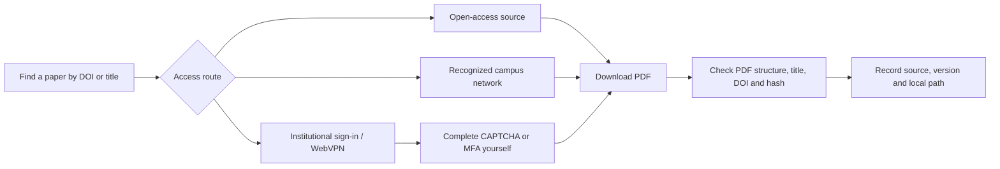

# Campus Library Papers

[简体中文](README.md) · **English**

A local companion for finding and downloading papers available through open access or your institution. It combines a campus-style account configuration portal, browser-assisted institutional sign-in, DOI-based retrieval, and PDF verification. Wuhan University of Technology is the default configuration.


This is an independent tool, not an official university sign-in page. Saving credentials does not prove successful authentication or access to a particular journal. Real university-account sign-in still requires on-site validation.

## Choose a version

| Version | Purpose | What it contains |
|---|---|---|
| v1.0.0 | Historical compatibility | The original CLI-oriented implementation, preserved at the original main commit |
| v2.0.0 | Recommended for new users | Local configuration portal, Chinese/English interface, verification, documentation and tests |
| main | Current maintained source | The latest integrated version; feature branches are merged here through pull requests |

Version 1 remains a historical snapshot rather than being overwritten. See [release notes](CHANGELOG.md). New releases are built from the version recorded in `VERSION` only after tests pass. Existing releases are not replaced.

## How the workflow works



The portal distinguishes configuration, authentication and paper verification. A saved configuration never marks authentication as complete automatically. Preprints, accepted manuscripts and published versions should be recorded separately.

## Start the portal

Python **3.10+** is required. The UI uses the standard library; there is no npm build, external font, analytics script or remote credential service.

```bash
python campus_portal.py
```

Keep the terminal open and use the local browser page. Stop the service with **Ctrl+C**. Do not disable security software or restore a quarantined legacy launcher.

- Select **中文 / EN** in the header. Only the language preference is stored in browser local storage.
- Enter your campus account and password. The portal saves them in the local plain-text file `登录配置.private.json`.
- Existing credentials are not returned to the page. Blank fields preserve saved values; changing the account requires the corresponding password.
- The optional automatic submission setting permits one click only when no CAPTCHA is detected. CAPTCHA, QR-code and SMS verification remain your responsibility.

For a credential-free preview:

```bash
python campus_portal.py --demo
```

Or open [the project showcase](docs/index.html) or [the standalone static demo](docs/demo/index.html). The demo simulates saving in the current page and neither reads nor writes actual credentials. GitHub Pages may serve `docs/demo/`; it must not host the real credential service.

## Institutional sign-in and download

The independent browser CLI requires **Node 22+** and installed Edge or Chrome. Use it only where the host permits that automation; otherwise use the host's supported browser tools.

```bash
node skill-src/scripts/browser_dl.js --login --credentials 登录配置.private.json
node skill-src/scripts/browser_dl.js --url "ARTICLE_URL" --out papers --no-proxy
```

Keep authentication and download in the same browser profile. It does not automatically share sessions with your ordinary browser. Use `--no-proxy` only when a system proxy interferes with recognized campus access. Neither a successful network request nor an institutional logo proves access to the requested paper.

For OA retrieval and PDF verification:

```bash
python -m pip install -r requirements-dev.txt
python skill-src/scripts/paper_oa.py fetch "10.1016/j.esci.2023.100174" --out papers
python skill-src/scripts/paper_oa.py import-file "paper.pdf" --doi "TARGET_DOI" --title "FULL_TITLE" --out papers
python skill-src/scripts/paper_oa.py organize papers
```

The optional `pypdf` dependency checks PDF structure and extracts front matter for title/DOI matching. `saved_pending_verification` means the file exists but verification is incomplete. Scans, encrypted files, title variations and one-page documents may require manual review. Verification does not establish redistribution rights.

## Capabilities and limits

| Capability | Current behavior |
|---|---|
| Account portal | Responsive local UI, validation, password visibility and status feedback |
| Metadata/OA | DOI, arXiv and supported biomedical identifiers; provider availability varies |
| Browser download | Institutionally authorized sessions, sequential downloads and human verification handoff |
| Archiving | SHA-256, source, local path, title, version and explicit verification status |
| Protected access | No paywall bypass, CAPTCHA solving or fabricated institutional identity |
| Authentication | Real school login must be validated in the user's environment |

## Repository and release layout

```text
main                 latest integrated source
feature branch       work in progress, merged through a pull request
v1.0.0               preserved original version
v2.0.0               current portal-oriented release
```

The repository tracks source, examples, docs and tests. Papers, private configurations, browser profiles, caches and backups are excluded from the current source tree. Historical commits remain unchanged.

```bash
python -m unittest discover -s skill-src/tests -p "test_*.py" -v
node --test skill-src/tests/test_browser.js skill-src/tests/test_login.js skill-src/tests/test_i18n.js
python skill-src/scripts/webvpn_url.py --selftest
python export_public.py --out dist/campus-library-papers
```

CI configuration is in `.github/workflows/test.yml`. After tests pass on main, release automation preserves v1 and publishes the new version specified in `VERSION`, with a clean source ZIP. Cloud CI is considered verified only after the actual run succeeds.

For new development, create a short-lived branch, open a PR, pass tests, and merge into main. To release a new version, update both `VERSION` and `CHANGELOG.md`; do not create permanent version branches.

## Security and publication

Never commit `登录配置.private.json`, downloaded papers, manifests containing personal paths, or browser data. `.gitignore` does not remove already tracked files. Use the allowlist exporter and inspect its output before publishing. See [SECURITY.md](SECURITY.md).

The project owner still needs to select a license before advertising an open-source license. The presence of public source does not imply that this project is an official university service.

## Validation snapshot

50 Python and 30 Node offline tests pass locally. Language switching, English validation and simulated saving were checked in the local browser. Institutional authentication and live full-text downloads still need validation in the user environment.
