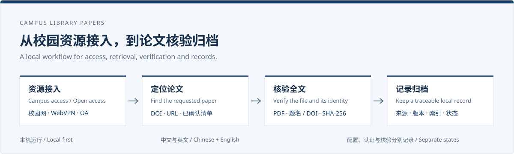
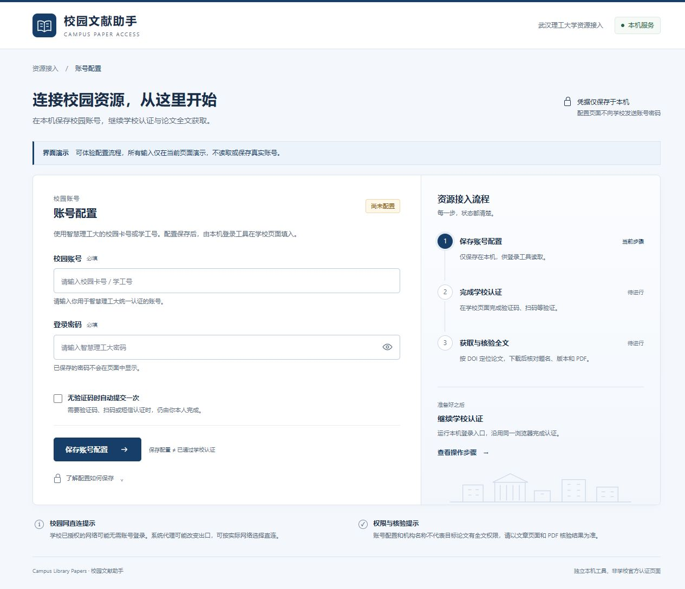
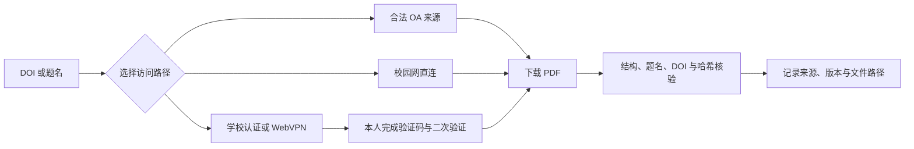
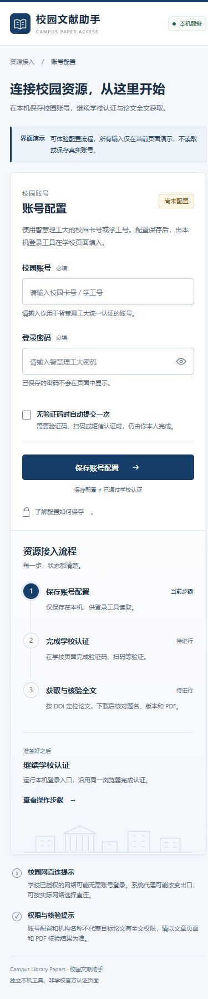
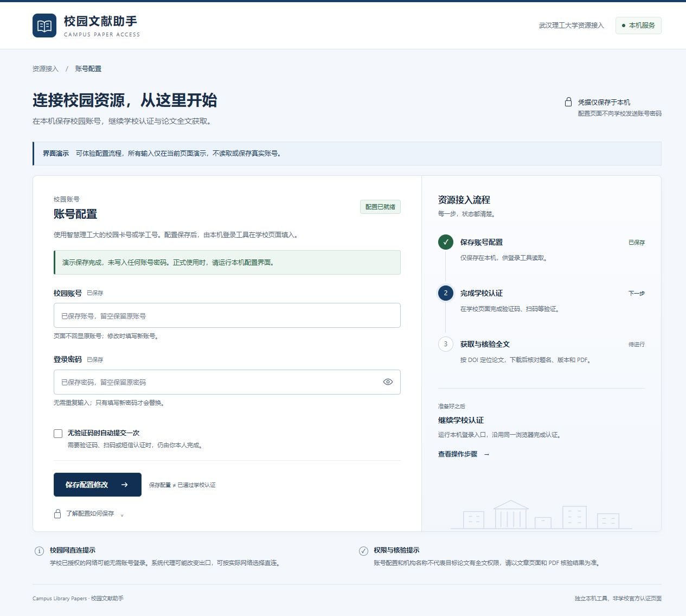

# 校园文献助手 · Campus Library Papers

**简体中文** · [English](README.en.md)

让校园资源接入、指定论文获取和全文核验成为一条可以接续、可以检查的本地工作流。



[下载 v2.0.0](https://github.com/PengyuLaider/WUT-Acadamic-Download/releases/tag/v2.0.0) · [快速开始](#快速开始) · [核心能力](#核心能力) · [输出与状态](#最后会得到什么) · [常见问题](#常见问题)


**本机运行** · **中文 / English** · **Python 3.10+** · **可选 Node 22+ 浏览器工具** · **默认武汉理工大学**

## 这个项目解决什么问题

科研中，拿到 DOI 并不意味着已经拿到可用的全文：学校认证可能在另一个浏览器里，数据库页面可能需要人工验证，保存的文件也可能是网页、附件或另一篇论文。下一次让智能体接续时，还需要知道上一次停在哪一步。

校园文献助手把这些环节放到同一套流程中：在本机配置校园账号，按当前网络选择开放获取或学校授权路径，获取指定论文后检查文件与篇目信息，再记录来源、版本、位置和核验状态。

| 组成 | 你会用它做什么 |
|---|---|
| 本机配置门户 | 用可视化表单保存校园账号，查看配置是否就绪，了解下一步认证流程 |
| 论文获取与核验工具 | 按 DOI、文章链接或已确认清单定位全文，处理本地 PDF 并生成索引 |
| 智能体 skill | 让支持 skill 的宿主按一致流程执行，需要本人验证时保留进度交接 |

**配置页面负责账号设置；学校登录、全文下载和 PDF 核验由相应工具接续执行。** 保存成功、学校认证成功和论文核验成功分别记录。真实学校认证与逐篇下载仍需在使用者的实际环境验收。

## 适合哪些场景

- **研究生与科研人员**：从 DOI 或文献清单出发，获取有权访问的论文，减少重复查找入口和整理文件的工作。
- **课题组的文献积累**：保存每篇的来源与文件指纹，为后续阅读、整理和人工复核留下依据；公开仓库不存放论文全文。
- **智能体协作与接力**：明确目标、浏览器会话、输出目录和待处理事项，遇验证码或二次验证时由本人接手。
- **工具展示与开发**：通过无账号演示查看门户布局、字段提示和状态变化，无需填写真实校园凭据。

## 核心能力

| 能力 | 实际行为 | 使用时注意 |
|---|---|---|
| 校园门户式配置 | 白底深蓝、响应式布局、字段校验与保存反馈 | UI 仅用 Python 标准库，无需 npm 构建 |
| 中英双语 | 切换字段、说明、校验与保存提示 | 浏览器只记住语言偏好；已保存的账号密码不返回页面 |
| 学校资源接入 | 默认提供武汉理工大学校园网、WebVPN / CARSI 相关入口与说明 | 机构标识或 HTTP 200 不能证明某篇论文有全文权限 |
| OA 与指定论文 | 支持 DOI 等标识符、文章 URL 和已确认清单；题名检索先列候选 | 来源不可达时保留不确定状态，不把失败当成“没有 OA” |
| 浏览器辅助 | 使用获授权的会话；独立 CLI 可运行本机 Edge / Chrome | 需 Node 22+，独立浏览器与其他浏览器不自动共享登录 |
| PDF 核验 | 检查结构、SHA-256、题名和 DOI | 扫描件、加密文件、题名差异或单页文件可能需要人工查看 |
| 索引与发布 | JSONL 记录、CSV 索引、白名单源码导出 | 公开源码包排除真实配置、论文、浏览器数据和备份 |

### 先看界面



截图为演示数据。更多 [手机与保存状态](#界面预览) · [英文预览](docs/images/portal-english.png) · [展示页源码](docs/index.html) · [静态演示源码](docs/demo/index.html)。静态页面下载后可在本机打开；GitHub 文件页显示源码，独立 GitHub Pages 站点尚未启用。

## 从检索到核验



账号配置、学校认证和论文核验是三个独立状态。不会因保存成功就显示已通过认证，也不会把预印本当成期刊出版稿。

1. 确认篇目与目标版本，题名检索有多个候选时先选择。
2. 按当前网络和学校支持方式选择 OA、校园网、CARSI 或 WebVPN。
3. 在学校或数据库页面完成本人验证后，继续原会话。
4. 保存文件后检查结构与题名 / DOI，再登记结果与失败原因。

## 快速开始

### 选择你要用的入口

| 你的目标 | 需要什么 | 从哪里开始 |
|---|---|---|
| 看界面、体验交互 | Python 3.10+，或下载后的静态演示 | `python campus_portal.py --demo` |
| 配置本机账号 | Python 3.10+ | `python campus_portal.py` |
| OA 定位与 PDF 核验 | Python 3.10+；核验需 pypdf | 下方 OA 与本地导入命令 |
| 独立浏览器辅助 | Node 22+、Edge / Chrome、允许该自动化的宿主 | 下方学校认证与浏览器命令 |
| 让智能体接续 | 支持 skill 的宿主及其允许的浏览器 / 文件工具 | [智能体 skill](#智能体-skill) |

先从 [Releases](https://github.com/PengyuLaider/WUT-Acadamic-Download/releases) 下载 `campus-library-papers.zip` 并解压，在解压目录打开终端；也可以克隆仓库使用 `main` 的最新源码。

Python 3.10+。配置界面只用标准库，无需 npm、pip 或前端构建。

```bash
python campus_portal.py
```

浏览器打开本机页面，在界面填写校园账号和密码后保存。正式模式将凭据以**明文**保存在本机 `登录配置.private.json`；页面不返回已保存的值，留空可以保留原配置。终端保持前台运行，按 Ctrl+C 停止。不要关闭安全软件、恢复被隔离的旧启动脚本或为本工具添加白名单。

仅展示界面、不要读取或保存真实账号时：

```bash
python campus_portal.py --demo
```

也可以先打开 [项目展示页](docs/index.html) 或 [静态演示](docs/demo/index.html)，或者把 `docs` 作为 GitHub Pages 的发布目录，访问其中的 `demo/`。静态演示不是远程账号登录服务。

## 继续学校认证与论文下载

浏览器 CLI 需要 Node 22+ 和 Edge/Chrome。只有宿主允许这种自动化时使用；否则通过宿主支持的浏览器工具操作。

```bash
node skill-src/scripts/browser_dl.js --login --credentials 登录配置.private.json
node skill-src/scripts/browser_dl.js --url "文章URL" --out papers --no-proxy
```

配置界面保存在完整工具包根目录。验证码、扫码和手机验证由本人完成；不要反复自动重试错误密码。独立浏览器与其他浏览器会话不自动共享登录。

`--no-proxy` 让独立浏览器按正常网络直连；仅在系统代理影响校园授权时按需选择，不保证所有网络都可用。

PDF 结构和篇目核验需要可选 `pypdf`：

```bash
python -m pip install -r requirements-dev.txt
python skill-src/scripts/paper_oa.py fetch "10.1016/j.esci.2023.100174" --out papers
python skill-src/scripts/paper_oa.py import-file "已下载.pdf" --doi "目标DOI" --title "完整题名" --out papers
python skill-src/scripts/paper_oa.py organize papers
```

浏览器保存后先标记 `saved_pending_verification`，核验成功后再记完成。预印本、出版稿及附件需分清。

## 最后会得到什么

```text
papers/
├── <论文文件>.pdf     获取或导入的全文
├── manifest.jsonl    来源、路径、哈希、版本与核验信息
└── index.csv         organize 根据登记记录生成的阅读索引
```

`organize` 处理已经登记的记录，不会把目录里的所有 PDF 自动导入。已确认的 DOI 清单可以逐行写入文本，用 `python skill-src/scripts/paper_oa.py batch "dois.txt" --out papers` 顺序处理。

| 常见状态 | 表示什么 | 下一步 |
|---|---|---|
| `downloaded` / `exists` | 文件存在、哈希有效，且通过本地自动篇目核验 | 阅读并确认稿件版本与使用权限 |
| `saved_pending_verification` | 已保存，但解析或篇目证据不足 | 补核验，必要时人工查看首页 |
| `selection_required` | 有多个候选，尚未确定目标 | 指定需要的篇目 |
| `need_user` | 需要本人登录或验证 | 完成当前页面验证后接续 |
| `source_unavailable` | 元数据源或网络失败 | 网络恢复后接续，或换合法来源 |
| `no_oa` | 当前已查询链路未定位 OA | 检查学校授权、合法替代版本或文献传递 |

自动核验不代表取得再传播许可。预印本、作者接受稿、出版稿和附件应分别记录。

## 智能体 skill

`skill-src/SKILL.md` 是可安装的 skill 入口，名称为 `campus-library-papers`，按宿主支持的安装方式使用。单独安装 skill 不包含根目录的配置界面；凭据文件需要显式指定路径。

可以这样向智能体描述任务：

> 使用校园文献下载 skill，获取 DOI 为 `10.1016/j.esci.2023.100174` 的论文，优先沿用我已登录的学校浏览器，保存到指定目录。遇到验证码时保留当前页面让我完成；最后报告文件路径、来源、版本与核验结果。

这是任务写法示例，不保证该论文在每个环境都能下载。接续记录保留目标 DOI、浏览器标签、步骤与输出目录，账号、Cookie 和验证码不写入交接记录。

## 中英文界面

顶部的 **中文 / EN** 可切换页面、字段说明、错误提示和保存反馈。浏览器只记住语言偏好，不保存输入的账号密码。中英文使用同一套表单和状态逻辑，文件名与命令保持原样。

## 常见问题

| 现象 | 如何处理 |
|---|---|
| 配置已就绪，但仍需登录 | 已保存不等于已认证，在同一个浏览器完成学校登录 |
| 需要验证码或扫码 | 由本人完成，工具不代填或绕过 |
| 机构名称出现但不能下载 | 目标期刊、年份或文章可能未授权，应逐篇确认 |
| 文件已保存但待核验 | 用 import-file 检查目标题名/DOI，扫描件和单页文件可能需要人工查看 |
| Python 命令失败 | 确认解释器为 Python 3.10+；UI 不需要第三方库，PDF 核验需 pypdf |
| 浏览器窗口未出现或被遮挡 | 在任务栏打开独立 Edge/Chrome，不要反复自动重登 |
| 安全软件报警 | 停止对应操作并保留记录，不关闭防护、不恢复隔离脚本 |

<details>
<summary>能保证知网、ScienceDirect、IEEE 等数据库都能下载吗？</summary>

不能。学校订阅范围、期刊年份、页面变化、验证和网络出口都会影响访问。通用流程与站点说明不等于所有数据库均已逐站验证；以目标文章和实际 PDF 为准。

</details>

<details>
<summary>其他学校能使用吗？这是在线下载网站吗？</summary>

OA 获取和本地核验不依赖特定学校。学校入口、认证允许域与 WebVPN 默认面向武汉理工大学，迁移需适配并验证。当前是本机工具与 skill，静态演示只模拟交互，真实账号配置服务在自己的电脑运行。

</details>

## 版本选择

| 版本 | 定位 | 内容 |
|---|---|---|
| v1.0.0 | 历史兼容版本 | 保留初始 main 的命令行实现，不覆盖旧代码 |
| v2.0.0 | 新用户推荐 | 本机门户、中英文切换、配置反馈、核验与离线测试 |
| main | 持续维护主线 | 集成通过测试的新功能，供默认浏览与下载 |

v1.0.0 固定到原始提交 `3c1df54`，旧版源码单独归档；附带归档不打包论文。Git 历史保持原样。v2.0.0 维护当前门户与完整流程。

## 版本与分支

- `main`：默认分支，保留最新可用源码，普通使用者从这里下载。
- 功能分支：暂存开发中的改动，通过 Pull Request 合并回 `main`。
- Releases：用 `v2.0.0` 等标签固定可下载版本；更新记录见 [CHANGELOG.md](CHANGELOG.md)。

每次更新沿用“功能分支 → Pull Request → 测试通过 → 合并 main → 发布版本”，不用为每个版本长期保留一条分支。已合并分支可按需要归档或删除；历史提交可追溯。

发布版本时同步修改 `VERSION` 与 `CHANGELOG.md`。合并到 `main` 后，自动测试通过才会按版本号创建 Release，并附上排除本机数据的源码 ZIP；已有版本不会覆盖。

`main` 的文档可能比已发布 ZIP 更新，已有 Release 不覆盖。固定版本请前往 [v2.0.0](https://github.com/PengyuLaider/WUT-Acadamic-Download/releases/tag/v2.0.0) 或 [v1.0.0](https://github.com/PengyuLaider/WUT-Acadamic-Download/releases/tag/v1.0.0)。

## 界面预览

桌面展示见上图，其他布局与状态：

| 手机布局 | 配置保存后的状态 |
|---|---|
|  |  |

这些截图是无真实账号的演示数据。新增加的中英文切换以当前代码与静态演示为准，旧截图保留原布局示例。

## 开发与测试

```bash
python -m unittest discover -s skill-src/tests -p "test_*.py" -v
node --test skill-src/tests/test_browser.js skill-src/tests/test_login.js skill-src/tests/test_i18n.js
python skill-src/scripts/webvpn_url.py --selftest
```

Python 测试仅使用假账号和临时目录；不会登录学校。Windows 网络诊断另见 `skill-src/tests/test_network.ps1`。GitHub Actions 配置在 `.github/workflows/test.yml`，CI 是否通过以仓库实际运行结果为准。

界面核验记录：[界面与验证](docs/界面与验证.md)。

## 上传 GitHub

请使用新导出的干净目录，而不是直接上传带论文与备份的工作目录：

```bash
python export_public.py --out GitHub发布包/campus-library-papers
```

导出文件包含源码、空白配置示例、截图、静态演示和测试；排除真实账号文件、用户配置、论文、清单、浏览器数据、备份与缓存，并生成文件哈希清单及 ZIP。

`.gitignore` 无法移除已经跟踪过的敏感文件。不要提交 `登录配置.private.json`；不要上传学校订阅论文。发布前由仓库所有者确定许可证；本项目尚未声明开源许可证。

## 目录

```text
campus_portal.py             本机配置服务（前台运行）
ui/                          HTML / CSS / JS
登录配置.example.json        空白公开示例
skill-src/                   论文获取 skill 与脚本
skill-src/tests/             离线回归
docs/demo/                  无账号静态演示
docs/images/                演示界面截图
export_public.py             公开发布包导出
```

更多数据处理说明见 [SECURITY.md](SECURITY.md)。

## 反馈与项目边界

问题反馈请附系统、Python / Node 版本、执行步骤与脱敏错误信息，通过 [Issues](https://github.com/PengyuLaider/WUT-Acadamic-Download/issues) 提交。不要附真实账号文件、Cookie、浏览器 profile 或订阅论文。

本项目为独立工具，非学校官方服务。当前仓库尚未声明开源许可证；公开可见不等于已经授予任意使用许可。数据处理见 [SECURITY.md](SECURITY.md)。

## 使用报告后的修复候选

2026-11-01：候选过滤、下载后核验与隔离、批次进度与续跑、单行导入 JSON、文件命名与稿件版本、独立安装凭据路径与运行时选择已做离线修复。当前 52 项 Python、35 项 Node 回归通过；现场待办与逐项结论见 [使用报告接续](skill-src/references/usage-report-handoff.md)。本分支尚未完成真实学校登录及出版社下载验收。
