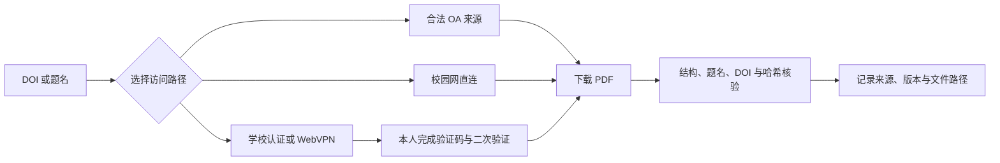

# 校园文献助手 · Campus Library Papers

**简体中文** · [English](README.en.md)

本地运行的校园网论文获取工具与智能体 skill。支持账号配置、学校认证辅助、OA 定位、指定论文下载和 PDF 核验。默认学校为武汉理工大学。

## 版本与分支

- `main`：默认分支，保留最新可用源码，普通使用者从这里下载。
- 功能分支：暂存开发中的改动，通过 Pull Request 合并回 `main`。
- Releases：用 `v2.0.0` 等标签固定可下载版本；更新记录见 [CHANGELOG.md](CHANGELOG.md)。

每次更新沿用“功能分支 → Pull Request → 测试通过 → 合并 main → 发布版本”，不用为每个版本长期保留一条分支。已合并分支可按需要归档或删除；历史提交可追溯。

发布版本时同步修改 `VERSION` 与 `CHANGELOG.md`。合并到 `main` 后，自动测试通过才会按版本号创建 Release，并附上排除本机数据的源码 ZIP；已有版本不会覆盖。


> 独立工具，非学校官方认证页面。学校账号登录尚待现场验收；配置就绪不等于学校已认证或所有论文都有订阅权限。

## 功能

| 能力 | 说明 |
|---|---|
| 校园门户界面 | 白底深蓝、响应式布局、行内反馈、密码切换 |
| 接入流程可视化 | 区分账号保存、学校认证、全文下载核验 |
| 本机私密配置 | 页面不回显已保存账号密码，不接入外部服务 |
| 无账号演示 | 页面模拟保存，可用于 GitHub 展示 |
| 论文获取 | DOI、文章 URL、清单；OA 或学校授权路径 |
| 文件核验 | PDF 结构、题名/DOI、哈希与索引 |

## 版本选择

| 版本 | 定位 | 内容 |
|---|---|---|
| v1.0.0 | 历史兼容版本 | 保留初始 main 的命令行实现，不覆盖旧代码 |
| v2.0.0 | 新用户推荐 | 本机门户、中英文切换、配置反馈、核验与离线测试 |
| main | 持续维护主线 | 集成通过测试的新功能，供默认浏览与下载 |

v1.0.0 固定到原始提交 `3c1df54`，旧版源码单独归档；附带归档不打包论文。Git 历史保持原样。v2.0.0 维护当前门户与完整流程。

## 从检索到核验



账号配置、学校认证和论文核验是三个独立状态。不会因保存成功就显示已通过认证，也不会把预印本当成期刊出版稿。

## 快速开始

Python 3.10+。配置界面只用标准库，无需 npm、pip 或前端构建。

```bash
python campus_portal.py
```

浏览器打开本机页面，在界面填写校园账号和密码后保存。终端保持前台运行，按 Ctrl+C 停止。不要关闭安全软件、恢复被隔离的旧启动脚本或为本工具添加白名单。

仅展示界面、不要读取或保存真实账号时：

```bash
python campus_portal.py --demo
```

也可以先打开 [项目展示页](docs/index.html) 或 [静态演示](docs/demo/index.html)，或者把 `docs` 作为 GitHub Pages 的发布目录，访问其中的 `demo/`。静态演示不是远程账号登录服务。

## 继续学校认证与论文下载

浏览器 CLI 需要 Node 22+ 和 Edge/Chrome。只有宿主允许这种自动化时使用；否则通过宿主支持的浏览器工具操作。

```bash
node skill-src/scripts/browser_dl.js --login --credentials 登录配置.private.json
node skill-src/scripts/browser_dl.js --url "文章URL" --out papers --no-proxy
```

配置界面保存在完整工具包根目录。验证码、扫码和手机验证由本人完成；不要反复自动重试错误密码。独立浏览器与其他浏览器会话不自动共享登录。

`--no-proxy` 让独立浏览器按正常网络直连；仅在系统代理影响校园授权时按需选择，不保证所有网络都可用。

PDF 结构和篇目核验需要可选 `pypdf`：

```bash
python -m pip install -r requirements-dev.txt
python skill-src/scripts/paper_oa.py fetch "10.1016/j.esci.2023.100174" --out papers
python skill-src/scripts/paper_oa.py import-file "已下载.pdf" --doi "目标DOI" --title "完整题名" --out papers
python skill-src/scripts/paper_oa.py organize papers
```

浏览器保存后先标记 `saved_pending_verification`，核验成功后再记完成。预印本、出版稿及附件需分清。

## 智能体 skill

`skill-src/SKILL.md` 是可安装的 skill 入口，名称为 `campus-library-papers`，按宿主支持的安装方式使用。单独安装 skill 不包含根目录的配置界面；凭据文件需要显式指定路径。

## 开发与测试

```bash
python -m unittest discover -s skill-src/tests -p "test_*.py" -v
node --test skill-src/tests/test_browser.js skill-src/tests/test_login.js skill-src/tests/test_i18n.js
python skill-src/scripts/webvpn_url.py --selftest
```

Python 测试仅使用假账号和临时目录；不会登录学校。Windows 网络诊断另见 `skill-src/tests/test_network.ps1`。GitHub Actions 配置在 `.github/workflows/test.yml`，CI 是否通过以仓库实际运行结果为准。

界面核验记录：[界面与验证](docs/界面与验证.md)。

## 上传 GitHub

请使用新导出的干净目录，而不是直接上传带论文与备份的工作目录：

```bash
python export_public.py --out GitHub发布包/campus-library-papers
```

导出文件包含源码、空白配置示例、截图、静态演示和测试；排除真实账号文件、用户配置、论文、清单、浏览器数据、备份与缓存，并生成文件哈希清单及 ZIP。

`.gitignore` 无法移除已经跟踪过的敏感文件。不要提交 `登录配置.private.json`；不要上传学校订阅论文。发布前由仓库所有者确定许可证；本项目尚未声明开源许可证。

## 目录

```text
campus_portal.py             本机配置服务（前台运行）
ui/                          HTML / CSS / JS
登录配置.example.json        空白公开示例
skill-src/                   论文获取 skill 与脚本
skill-src/tests/             离线回归
docs/demo/                  无账号静态演示
docs/images/                演示界面截图
export_public.py             公开发布包导出
```

更多数据处理说明见 [SECURITY.md](SECURITY.md)。

## 中英文界面

顶部的 **中文 / EN** 可切换页面、字段说明、错误提示和保存反馈。浏览器只记住语言偏好，不保存输入的账号密码。中英文使用同一套表单和状态逻辑，文件名与命令保持原样。

## 常见问题

| 现象 | 如何处理 |
|---|---|
| 配置已就绪，但仍需登录 | 已保存不等于已认证，在同一个浏览器完成学校登录 |
| 需要验证码或扫码 | 由本人完成，工具不代填或绕过 |
| 机构名称出现但不能下载 | 目标期刊、年份或文章可能未授权，应逐篇确认 |
| 文件已保存但待核验 | 用 import-file 检查目标题名/DOI，扫描件和单页文件可能需要人工查看 |
| Python 命令失败 | 确认解释器为 Python 3.10+；UI 不需要第三方库，PDF 核验需 pypdf |
| 浏览器窗口未出现或被遮挡 | 在任务栏打开独立 Edge/Chrome，不要反复自动重登 |
| 安全软件报警 | 停止对应操作并保留记录，不关闭防护、不恢复隔离脚本 |

## 界面预览

桌面展示见上图，其他布局与状态：

| 手机布局 | 配置保存后的状态 |
|---|---|
|  |  |

这些截图是无真实账号的演示数据。新增加的中英文切换以当前代码与静态演示为准，旧截图保留原布局示例。

## English preview


中英文切换、英文空表单校验及模拟保存已在本机浏览器检查。完整离线回归为 50 项 Python 与 30 项 Node 测试；不代表学校认证与真实下载已完成验收。
